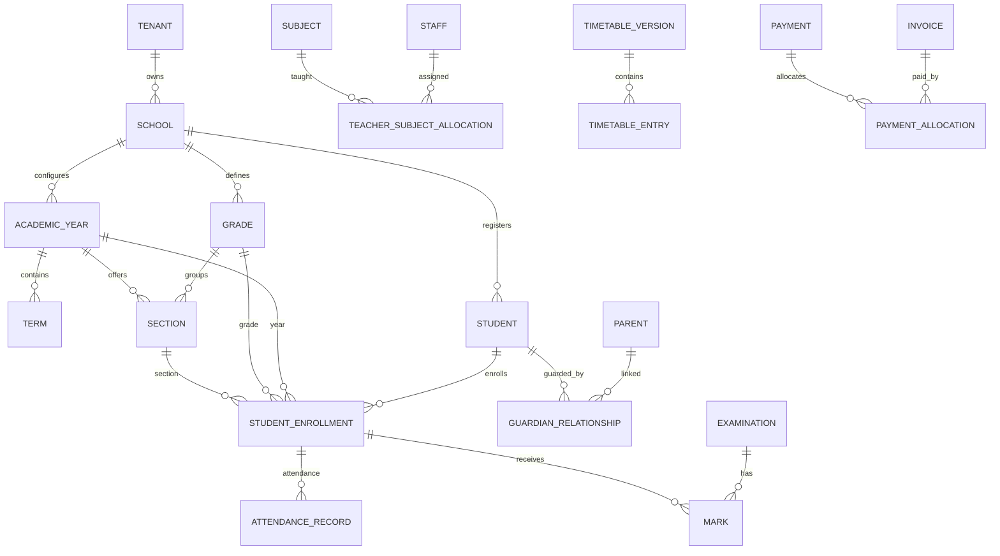

# MMK School - Logical ERD & Data Dictionary v1.0

> Logical design baseline. Confirm physical types, indexes, composite tenant constraints and Drizzle conventions during implementation review.

## 1. Core relationships

## 2. Shared conventions

- `id`: UUID primary key.
- `school_id`: tenant/school ownership on tenant-owned records.
- `created_at`, `created_by`, `updated_at`, `updated_by`: standard metadata where relevant.
- `lifecycle_status`: active/inactive/archived or a domain-specific state machine.
- `archived_at`, `archived_by`, `archive_reason`: archivable records.
- Timestamps: timezone-aware. Date-only fields: DATE.
- Money: NUMERIC, never floating point; include currency code.
- No routine hard-delete endpoints. Preserve audit and financial events.

## 3. Identity and access

### tenants
`id`, `tenant_key`, `status`, `created_at`.

### schools
`id`, `tenant_id`, `school_code`, `name`, `timezone`, `default_language`, `board`, `school_type`, `status`, timestamps. Unique `(tenant_id, school_code)`.

### users
Authentication identity independent of school membership: `id`, normalized email/phone, display name, account status, timestamps.

### school_memberships
`id`, `school_id`, `user_id`, membership status, joined/ended dates. Unique `(school_id, user_id)`.

### roles, permissions, role_permissions, user_role_assignments
Support platform-scoped and school-scoped roles. Assignments have scope and optional effective dates.

### mfa_methods and sessions
Use vetted encrypted secret storage; recovery codes as hashes. Never store plaintext OTP/recovery codes.

## 4. Academic structure

### academic_years
`id`, `school_id`, `name`, `code`, `start_date`, `end_date`, admission window, status, `is_primary_active`. Validate date ranges and only one primary active year by default.

### terms
`id`, `school_id`, `academic_year_id`, name, code, sequence, start/end date, status.

### grades
`id`, `school_id`, name, code, display order, level category, status.

### sections
`id`, `school_id`, `academic_year_id`, `grade_id`, name, code, capacity, class teacher, classroom, status.

### subjects and grade_subjects
Subject catalogue plus academic-year-specific assignment to grade, compulsory/optional flag and assessment scheme.

### school_shifts, working_day_rules, period_templates, period_slots
Shift and timetable configuration is school-specific. Period slots define ordered teaching, break or activity periods with start/end times.

## 5. Student and guardian domain

### students
Permanent identity: `id`, `school_id`, `admission_number`, names, date of birth and approved profile fields. Unique `(school_id, admission_number)`.

### student_enrollments
Year-specific placement: `id`, `school_id`, `student_id`, `academic_year_id`, `grade_id`, `section_id`, `roll_number`, enrollment date, status, previous enrollment. Normally unique `(school_id, student_id, academic_year_id)`.

### parent_profiles
Parent/guardian profile optionally linked to a login user. A guardian profile may exist before portal activation.

### guardian_relationships
`id`, `school_id`, `student_id`, `parent_profile_id`, relationship type, primary flag, access scopes, effective dates and verification status. Never infer access from matching phone/email alone.

## 6. Staff and teaching allocation

### staff_profiles
Employment identity separate from login: employee code, optional user link, department, designation, employment status and dates.

### teacher_subject_allocations
Links staff, subject, grade, section, academic year, shift and effective dates.

### class_teacher_assignments
Links staff to a section for an academic year and effective period. Separate from subject allocation.

## 7. Timetable

### timetable_drafts
Mutable draft for academic year and shift.

### timetable_versions
Immutable published snapshot with version number, publisher, publication time and snapshot hash.

### timetable_entries
References timetable draft/version, section, day, period slot, subject, teacher, classroom and entry type. Validate no teacher/section/room collision for a time slot. Published versions are immutable.

## 8. Attendance

### attendance_sessions
School, academic year, date, shift, section, status and submitter.

### attendance_records
Session, student enrollment, status, marker, timestamp and note. Unique per session/enrollment.

### attendance_corrections
Original record, requester, reason, proposed status, decision, reviewer and review time. Preserve correction history.

## 9. Exams and results

Entities: `exam_types`, `examinations`, `exam_schedules`, `assessment_components`, `marks`, `grade_results`, `report_cards`, `result_publications`.

Marks reference enrollment, examination/component and subject. Keep draft marks separate from verified/published result versions.

## 10. Fees and payments

Entities: `fee_categories`, `fee_structures`, `student_fee_assignments`, `invoices`, `payment_records`, `payment_allocations`, `receipts`, `concessions`, `refunds`.

A payment is a transaction; allocations apply it to dues. Refunds are separate linked transactions. Corrections use reversals/adjustments, never deletion.

## 11. Admissions

Entities: `admission_cycles`, `admission_enquiries`, `admission_applications`, `application_documents`, `application_reviews`, `admission_decisions`, `application_status_history`.

Application conversion must be idempotent and transactional.

## 12. Files, notifications and audit

### file_assets
Metadata: school, storage key, original name, MIME type, size, checksum, uploader, related entity, visibility and retention class.

### notification_jobs / delivery_attempts / user_notifications
Separate notification request from per-channel delivery attempts. Track queued, accepted, delivered and failed only where provider data supports each state.

### audit_events
Append-only: school, actor, action, entity type/ID, timestamp, request ID, reason and before/after snapshots with sensitive-field redaction.

## 13. Integrity and index checklist

- Index school ID on tenant-owned tables.
- Composite indexes for common filters such as `(school_id, academic_year_id, grade_id, section_id)`.
- Unique school-scoped business identifiers.
- Foreign keys for internal relationships.
- Check constraints for date ranges, positive amounts and period start < end.
- Transactions for multi-record state changes.
- Idempotency-key storage for retry-sensitive operations.
- Composite tenant-consistency foreign keys or PostgreSQL RLS policies.
- Automated tenant-isolation tests for repositories and services.
